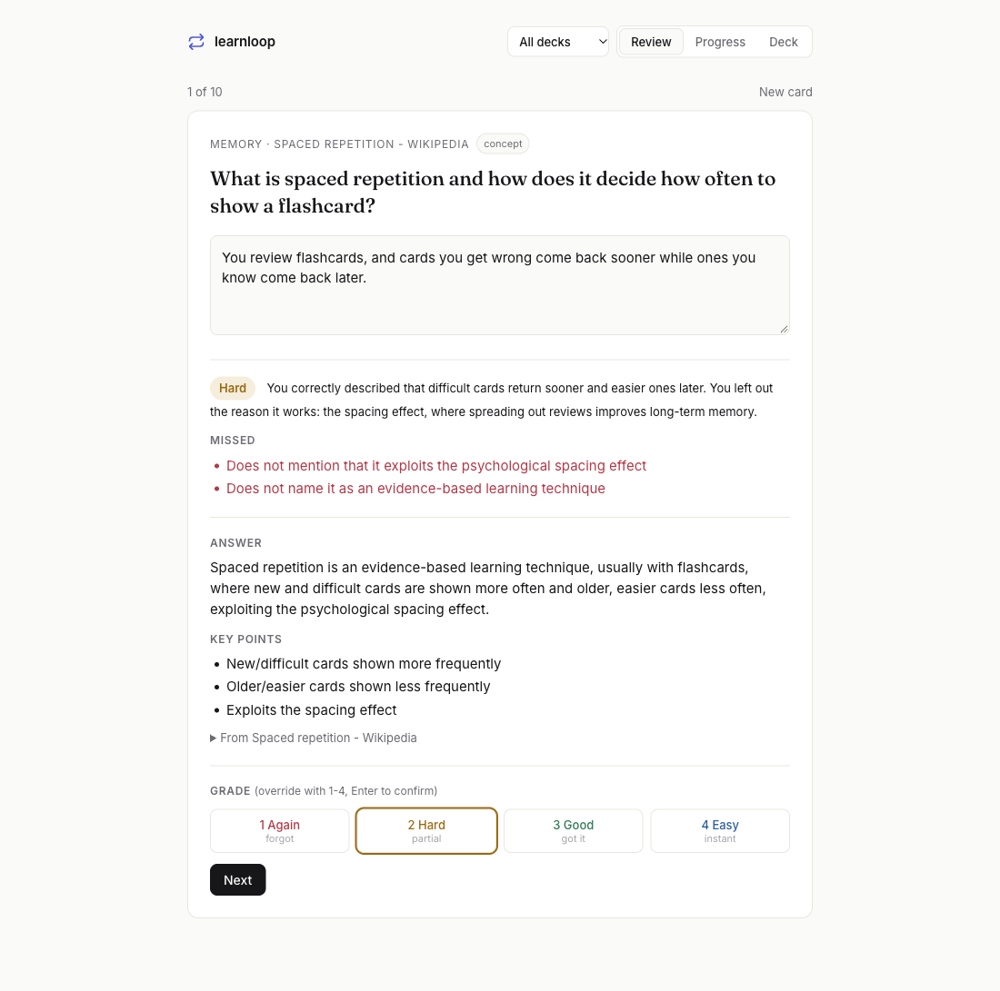

# learnloop

**A learning loop that tunes itself to you.**

Point it at anything you want to learn (notes, papers, a folder of Markdown, a web page). It writes study cards from that material, quizzes you with free-text recall, grades your answers with a model, and schedules each card to come back right before you'd forget it. Then it does the two things normal flashcard apps can't:

1. **It tunes its own scheduler from your history.** A model reads how you've actually been remembering and proposes new scheduling parameters. A proposal is only kept if replaying your full review history shows it predicts your recall better.
2. **It explains what you keep getting wrong.** Miss a card twice and it writes a short explanation from *your* wrong answers, aimed at the specific confusion, from a different angle than the card itself.

Inspired by [Patrick Collison](https://x.com/patrickc/status/2118352452923912419): *"The models are very good at creating custom spaced repetition apps with algorithms adapted to you and the problem domain ('review my learning and improve the efficiency of your scheduler') plus tailored explanations for anything that you consistently get wrong."*



## Quickstart

```bash
pip install git+https://github.com/cbudries-cloud/learnloop     # Python 3.10+, no other dependencies
export ANTHROPIC_API_KEY=sk-ant-...

learnloop add memory https://en.wikipedia.org/wiki/Spaced_repetition
learnloop add biochem ~/notes/biochem/          # folders, .md/.txt/.html, .pdf with `pip install pypdf`
learnloop serve                                 # http://127.0.0.1:3200
```

Ten new cards unlock per day across your decks (`LEARNLOOP_NEW_PER_DAY` to change). Everything is stored locally in `~/.learnloop/learnloop.db`.

## How it works

**Cards are anchored to the source.** Each card carries a verbatim quote from the material it was written from, and the quote is checked mechanically against the source text. Cards whose quote isn't really there are dropped, so the deck can't drift into facts the source never stated. Cards are typed (`concept`, `fact`, `process`, `distinction`, `number`, `application`) because different kinds of knowledge fade at different rates.

**Grading is about ideas, not wording.** You answer in your own words. The grader checks your answer against the card's key points, tells you what you missed, and names any misconception. You can always override the grade (keys 1-4).

**The scheduler is a small, fully tunable memory model.** Each card has a stability (days until recall drops to 90%) and a difficulty. Recall decays on a power curve, and the next review lands when predicted recall hits your target retention. Every number in the model is a parameter, including a per-kind multiplier, so the scheduler can learn that, say, you keep concepts for months but lose numbers in a week.

**Tuning is evidence-gated.** On the Progress page, *Review my learning and tune the scheduler* sends the model your replayed history: calibration (predicted vs actual recall), calibration by card kind, and the cards you struggle with. It proposes new parameters with a rationale. learnloop replays your entire history under the proposal and keeps it only if log loss drops. You see the diff and click Apply.

## Does the tuning actually help?

`learnloop bench` tests it on simulated learners whose memory secretly differs from the defaults in a known way. Each learner does 120 days of reviews. The model tunes on the first 80 days, and both parameter sets are scored on the last 40 days, which the tuner never saw. Log loss of predicted recall (lower is better); "oracle" is the learner's true hidden parameters.

| Simulated learner | Default | Tuned | Oracle | Gap closed |
|---|---|---|---|---|
| Matches the defaults (control) | 0.337 | 0.337 | 0.337 | no harm |
| Remembers much longer than assumed | 0.151 | 0.107 | 0.111 | ~100% |
| Forgets faster than assumed | 0.631 | 0.610 | 0.601 | 71% |
| Concepts stick, numbers fade | 0.578 | 0.555 | 0.550 | 81% |

In the last scenario the tuner found the planted pattern on its own: *"Number cards are the largest group and are badly overpredicted (0.763 predicted vs 0.682 observed)... I lowered their multiplier to 0.6."* Tuned beating the oracle in the "remembers longer" row is noise from a small holdout (180 reviews). Full output, including each rationale, is in [`docs/bench-results.json`](docs/bench-results.json). One run per scenario, single seed, so treat these as a demonstration rather than a benchmark.

## Models

| Job | Default model | Override |
|---|---|---|
| Writing cards, tuning the scheduler | `claude-opus-5-5` | `LEARNLOOP_DEEP_MODEL` |
| Grading answers, writing explanations | `claude-sonnet-5-5` | `LEARNLOOP_FAST_MODEL` |

## Notes

- The web UI binds to `127.0.0.1` and has no auth. It's meant for one person on one machine.
- Your typed answers and the relevant card text are sent to the model API for grading. Your source material is sent once, when cards are written.
- Tests: `python3 -m unittest discover -s tests`

MIT licensed.
